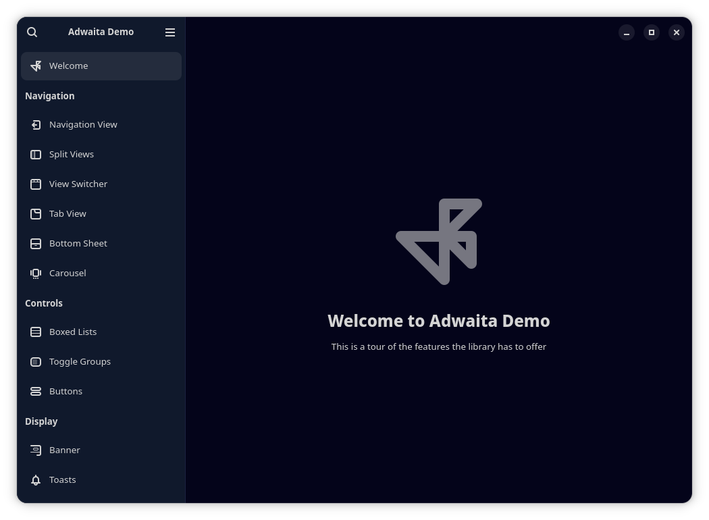

# Deepwick for libadwaita (GNOME apps)

Deep navy colors for GNOME apps built with libadwaita 1.6 or newer: Files,
Text Editor, Settings, Loupe, and more.

> Deepwick is an unofficial theme derived from
> [Polywick Blue](https://vscode.polywickstudio.net) by Polywick Studio (MIT).
> Not affiliated with Polywick Studio.



## Install

Copy the stylesheet next to your GTK 4 user CSS and import it at the end of
`gtk.css`. Append the line; don't replace the file, because desktop tools such as
Plasma's GTK integration keep their own lines there.

```sh
mkdir -p "${XDG_CONFIG_HOME:-$HOME/.config}/gtk-4.0"
cp deepwick.css "${XDG_CONFIG_HOME:-$HOME/.config}/gtk-4.0/"
echo "@import 'deepwick.css';" >> "${XDG_CONFIG_HOME:-$HOME/.config}/gtk-4.0/gtk.css"
```

Restart the apps. Use the system dark style; the theme also overrides light
mode, but some app-drawn content still follows the light/dark preference.

Flatpak apps need read access to that folder (untested):

```sh
flatpak override --user --filesystem=xdg-config/gtk-4.0:ro
```

To uninstall, delete the `@import 'deepwick.css';` line and `deepwick.css`.

## Notes

- Under Plasma, kde-gtk-config owns `gtk.css` and may rewrite it when you change
  the KDE color scheme; re-add the import line if it disappears.
- Text on accent, destructive, success and warning buttons is Background,
  because White is under 4.5:1 on Blue, Red and Green.
- Shadows are translucent black, and libadwaita mixes some colors (borders,
  dimmed text, banners) at partial opacity, so those pixels are blends of
  palette colors.
- Plain GTK 4 apps that don't use libadwaita, and GTK 3 apps, don't read these
  variables. Under Plasma, GTK 3 apps follow
  [Deepwick for KDE](https://github.com/deepwick/kde).

Tested with libadwaita 1.9.4 (GTK 4.22.5).

## License

MIT. See [LICENSE](LICENSE).
